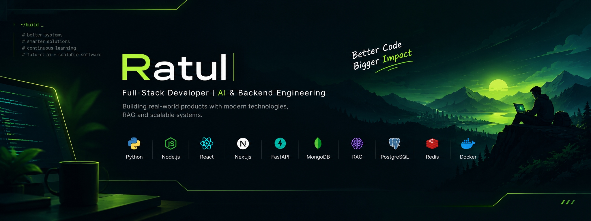

  
  
  

---

## About Me

I'm a Computer Science student at BRAC University with a strong interest in backend engineering, full-stack development, and applied AI. I enjoy building practical software from the ground up — designing backend systems, working with databases, building user-facing applications, and integrating AI into real-world products.

Recently, I've been focusing on building production-oriented projects, exploring Retrieval-Augmented Generation (RAG), scalable application architecture, and modern development practices. I'm continuously learning, experimenting, and improving my ability to turn ideas into reliable, maintainable software.

## Tech Stacks

### Languages

  
  
  
  

### Backend

  
  
  

### Frontend

  
  
  

### Database

  
  
  

### Infrastructure

  
  
  

### AI & Machine Learning

  
  
  
  

---

## Projects & Experience

### 🧠 AI Document Analyser — _Flagship Project_

A retrieval-augmented generation system that ingests documents and answers questions about them with grounded, streamed responses.

<table>
<tr>
<td valign="top" width="50%">

**RAG Pipeline**

- **Document ingestion** — parses and chunks source documents into retrievable segments
- **Embedding & indexing** — converts chunks into vectors and stores them for similarity search
- **Vector retrieval** — fetches the most relevant segments per query
- **Grounded generation** — answers are conditioned only on retrieved context

</td>
<td valign="top" width="50%">

**Response & Quality**

- **Streaming answers** — responses are token-by-token streamed to the client
- **Evaluation** — retrieval and answer quality are evaluated against a test set
- **Production-oriented** — built as a deployable service rather than a notebook script

  
  

</td>
</tr>
</table>

> **Repository:** `https://github.com/Ratul-code/REPO-NAME` &nbsp;•&nbsp; **Live Demo:** `https://YOUR-DEMO-URL.example.com`

 

### 🎓 Edu Flow — _Multi-Tenant Coaching Center Management System_

A web-based platform designed to help coaching centers manage their academic operations through a centralized system, with an architecture built around multiple organizations.

<table>
<tr>
<td valign="top" width="50%">

**Organization Management**

- **Multi-tenant architecture** — designed to support multiple coaching centers within one platform
- **Organization separation** — keeps each organization's data and operations logically isolated
- **Centralized management** — provides a foundation for managing coaching center activities

</td>
<td valign="top" width="50%">

**Platform & Development**

- **Modern web interface** — built with a responsive, user-friendly frontend
- **Scalable foundation** — structured to support the evolving needs of coaching centers
- **Practical application** — developed around real-world coaching center management workflows

  
  

</td>
</tr>
</table>

> **Repository:** `https://github.com/Ratul-code/Edu-Flow` &nbsp;•&nbsp; **Live Demo:** `https://edu-flow-697fadzfk-ratulcodes-projects.vercel.app/`

 

<!-- ### 🚧 More Projects

> _Placeholder — upcoming projects will be featured here._

| Project        | Description                                                      | Stack                   | Links                                                                                       |
| :------------- | :--------------------------------------------------------------- | :---------------------- | :------------------------------------------------------------------------------------------ |
| `PROJECT-NAME` | _Short one-line description of what it does and why it matters._ | `Python`, `FastAPI`     | [Repo](https://github.com/Ratul-code/REPO-NAME) · [Demo](https://YOUR-DEMO-URL.example.com) |
| `PROJECT-NAME` | _Short one-line description of what it does and why it matters._ | `TypeScript`, `Next.js` | [Repo](https://github.com/Ratul-code/REPO-NAME) · [Demo](https://YOUR-DEMO-URL.example.com) |

--- -->

## Education

<!-- <table>
<tr> -->
<!-- <td valign="top" width="50%"> -->

**BRAC University**  
Bachelor of Science (B.Sc.) in Computer Science  
_2024 – Present_  
Dhaka, Bangladesh

<!-- </td>
<td valign="top" width="50%"> -->

<!-- **🏆 Achievements**

- _Certification:_ `CERTIFICATION-NAME` — `Issuing Organization` (`YYYY`)
- _Research Publication:_ `PAPER-TITLE` — `Venue/Journal` (`YYYY`)
- _Award:_ `ACHIEVEMENT-NAME` — `Issuing Organization` (`YYYY`) -->

<!-- </td>
</tr>
</table> -->

Currently pursuing my undergraduate degree in Computer Science, building a strong foundation in software engineering, algorithms, data structures, and modern computing technologies.

---

## GitHub Statistics

---

## Footer

**Thanks for visiting — let's build something meaningful.**

